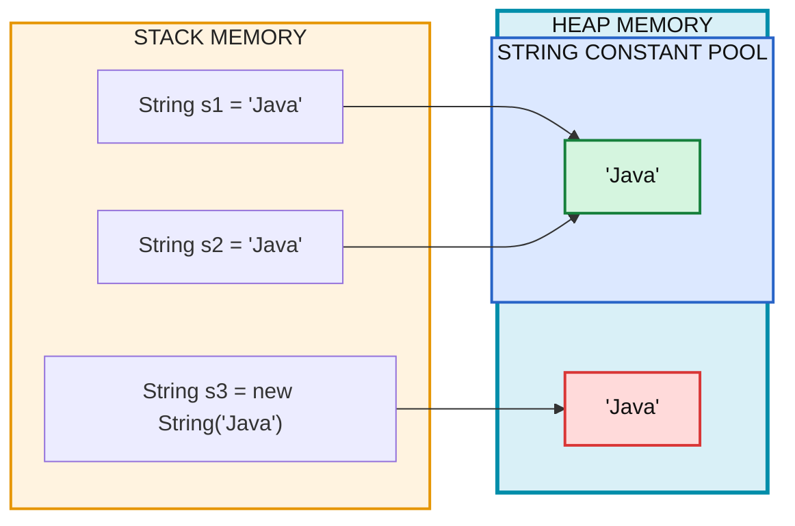
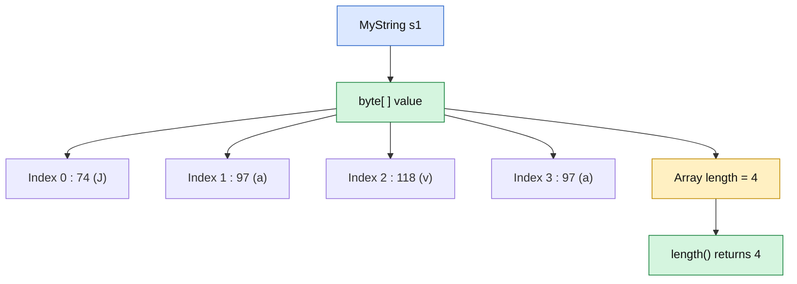

==🔵**String class**==
*Java strings are stored as objects. We can store strings with the help of objects of following classes.*
- `java.lang.String`
- `java.lang.StringBuilder`
- `java.lang.StringBuffer`

==🟡***Here are some points to be noted***==
- *String class is `public`*
- *String class is `final`*
- *String class extends `Object` Class*
- *String class implements `Comparable` interface, `serializable` interface, `charSequence` interface*

==🟡**Constructors of String class**==
➜ *`new String()` : It is used to create an empty string object.*
➜ *`new String(String s)` : It is used to create a string object with the given string.*
➜ *`new String(char [] chars)` : It is used to create string object with character arrays.*

==🟡**We can create string in two ways**==
- ==🟢*Using the string literals.*==
```java
String s1 = "java";
String s2 = "java";
```
*Here s1 and s2 are pointing to the same object reference of the string because of string pool.*

==🔴***NOTE : If the string object of the given string literal is already exits in the string pool area then a new string object will not be created instead of the address of the existing string object will be returned***==

- ==🟢*Using the new keyword.*==
```java
String s = new String("Java");
```

==🔴***NOTE : String object created with the new keyword are stored in the heap memory and with different address***==

==🔵**Immutability of strings in java**==
```java
String s1 = "Hello";
String s2 = s1;

s1 = s1.concat(" World");

System.out.println(s1); // Hello World
System.out.println(s2); // Hello
```
- *Here logically we should the same output for s1 and s2 for printing.*
- *But remember whenever we try to update the string , new string is created with that value and address of the string object is returned.*
- *Here when `s1` and `s2` are pointing to the same string object of `"Hello"` but when `s1` updated with new string `"Hello World"` then only `s1` is pointing to the new address and `s2` is still having the same address of `"Hello"` string object.*



**How String internally works**
```java
public final class MyString {

    private final byte[] value;

    public MyString(String input) {
        this.value = input.getBytes(
            java.nio.charset.StandardCharsets.ISO_8859_1
        );
    }

    public int length() {
        return value.length;
    }
}
```

- *Here the String stores the data in bytes after Java 9.*
- *`StandardCharsets.ISO_8859_1` : It is a character encoding supports 256 bytes from 0 ➜  255.*
- *The byte array is final so it can not be modified after first initialization.*
- *String also doesn't provide any method to direclty modify the byte array.*




==🔵***IMPORTANT METHODS IN STRING CLASS***==

- *`charAt(int index)` : It returns the character at given position.*
- *`length()` : It returns the number of character in a string.*
- *`substring(int beginIndex)` : It returns the substring starting from the given index to the end.*
- *`substring(int beginIndex, int endIndex)` : It returns the substring from start index to the end index and end index is not included.*
- *`subSequence(int start, int end)` : Returns the char sequence of a substring.*
- *`toLowerCase()` : Converts all the uppercase characters to lowercase and returns the string.*
- *`toUpperCase()` : Converts all the lowercase characters to uppercase and returns the string.*
- *`trim()` : Removes the white spaces from start and the end and returns the string.*
- *`strip()` : It also removes the white spaces from start and end but `trim` can only remove ASCII control space but `strip` can remove all unicode spaces characters.*
- *`equals(Object value)` : Check if two string objects are equal in values.*
- *`equalsIgnoreCase(String s)` : Check two strings are equal without checking lower or upper.*
- *`contains(String sequence)` : Check a sequence of characters is present in the string or not.*
- *`startsWith(String prefix)` : Check if string is starting with a prefix.*
- *`endsWith(String suffix)` : Check if an string is ending with a suffix.*
- *`indexOf(String substr, int beginIndex, int endIndex)` : It returns the first occurrence index of a substring.*
- *`lastIndexOf(String subsr, int beginIndex, int endIndex)` : It returns the last occurrence of a substring.*

⇒==🔴*Here the begin and end indexes are optional to search in range.*==
- *`cmpareTo(String s)` : This method is comes from the `Comparable` interface. It returns 0 for equal, positive if `s` is smaller than the string is compared with and negative if `s` is greater than the compared string. You need to understand `Comparable`*
- *`compareToIgnoreCase(String s)` : It works exactly the same like `compareTo` to but it doesn't care about upper and lower case when comparing.*
- *`concat(String val)` : Appends the `val` to the string and returns a new string.*
- *`replace(char oldChar, char newChar)` : It replaces all the `oldChar` character with `newChar` character. ==🟡We can also pass `String` instead of char then it will replace the sequence of `olderString` with `newString`.==*
- *`replaceAll(String regex, String replacement)` : It replaces all the `regex` substring matching value with the `replacement` substring in the string.*
- *`replaceFirst(String regex, String replacement)` : It works exactly same as `replaceAll` but here it replaces the first `regex` substring only.*
- 