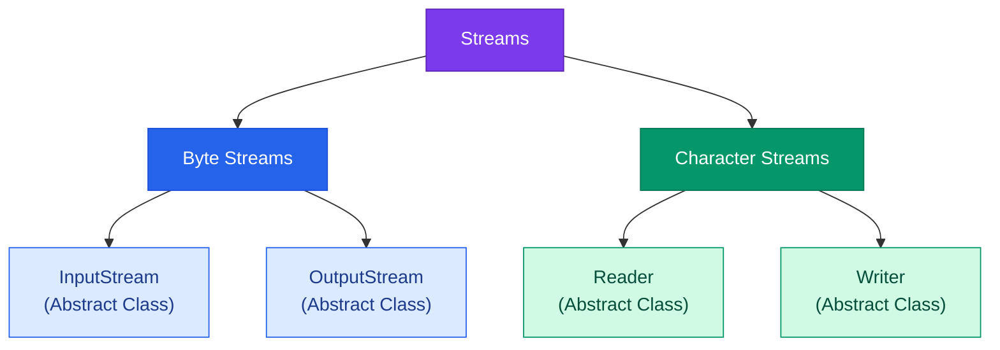

==🔵**Types of streams**==
*Stream is of two types :*
- *Input Stream*
- *Output Stream*

==🟠**Input Stream**==
- *It is used for reading the data.*
- *Data flows from File ➜ Program.*
- *Data comes into the program.*
- *Example : `FileInputStream`*

==🟠**Output Stream**==
- *It is used for writing the data.*
- *Data flows from Program ➜ File.*
- *Data goes from program to the file.*
- *Example : `FileOutputStream`*

==🔵*Byte Streams vs Character Streams*==

==🟠**Byte Stream**==
*It works with the bytes.*
*Base Classes are :*
```java
InputStream(abstract class)
OutputStream(abstract class)
```
*It is used for :*
- Images
- Videos
- PDFs
- Audio
- Zip files

==🟡*It only contains binary data.*==

==🟠**Character Stream**==
*It works with the character data.*
*Base Classes are :*
```java
Reader(abstract class)
Writer(abstract class)
```
*It is used for :*
- Text Files
- Names
- Sentences
- Paragraphs

==🟡*Example:*==
`hello.txt`
`student.txt`



