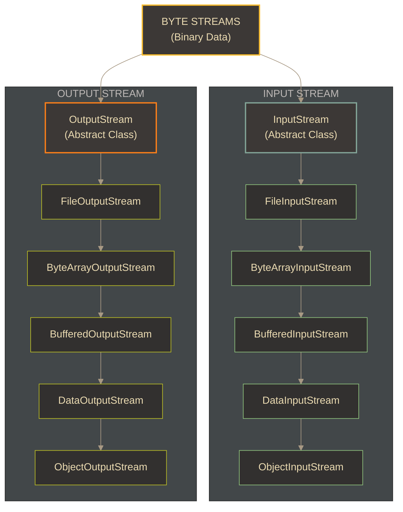

==🔵**Byte Stream**==
- `InputStream(abstract class)`
- `OutputStream(abstract class)`




==🟠***1. Input Stream***==
*`InputStream` is an abstract class so that we can not create an object of it.*
*Meaning that :*
```java
InputStream is = new InputStream();
```
**❌ Not possible**

==🔵**Important Methods**==

|     Method     | Return Type |                            Description                             |
| :------------: | :---------: | :----------------------------------------------------------------: |
|    `read()`    |    `int`    | Reads one byte and returns 0 to 255. In the end of file returns -1 |
| `available()`  |    `int`    |   Returns how many bytes are available to read without blocking.   |
|   `close()`    |   `void`    |                         Release resources.                         |
| `skip(long n)` |   `void`    |               Skip number of bytes from the stream.                |

==🟠**FileInputStream**==
*`FileInputStream` is a concrete class in Java's `java.io` package used to read ==🟡raw bytes from a file== into your program ==🟡one byte at a time== (or into a byte array).*

- *It reads data in the form of `byte` not characters and only one `byte` at a time.*
- *The `read()` method returns `int` instead of `byte` cause java use `-1` to indicate the end of file (EOF).*
- *When File contains `A` then the `read()` method returns `65` and `-1` if it reaches the end of file.*

==🟢*Constructors Of FileInputStream*==
⇒ *Pass a `File` object to the constructor*
```java
File file = new File("D:\\streams\\streams.txt");  
FileInputStream fis = new FileInputStream(file);
```

⇒ *Directly pass the file path to create `FileInputStream`*
```java
FileInputStream fis = new FileInputStream("D:\\streams\\streams.txt");
```

==🟡*Working of the `FileInputStream`*==
```java
public class MyFileInputStream {  
  
    static void main(String[] args) throws IOException {  
  
        FileInputStream fis = new FileInputStream("D:\\streams\\streams.txt");  
        int ch;  
        while ((ch = fis.read()) != -1) {  
            // Taking one byte at a time and casting that byte to char then printing  
            System.out.print((char) ch);  
        }  
        fis.close();  
    }  
}
```

- *Created a `FileInputStream` fis by passing the path directly.*
- *Now reading all the `byte` data in `int` only when not reaching the end of file.*
- *Casting the `ascii` returned value into character and printing it.*
- *After all we must close the stream by just calling the `close()` method.*

==🟠**FileOutputStream**==
*`FileOutputStream` is a concrete class in Java to write data into file. It writes data in the form of  `byte` data not `characters`.*
- *The `write` method accepts `int` value in parameter and write its corresponding `byte` value in the file.*
- *So when we call `write(65)` then it takes 65 and stores its `ASCII` value `A` in the file.*

==🟢*Constructors Of FileOutputStream*==
⇒ *Create `File` object and pass it in the `FileOutputStream` constructor.*
```java
File file = new File("D:\\streams\\streams.txt");  
FileOutputStream fos = new FileOutputStream(file);
```
⇒ *Directly pass the file path in the `FileOutputStream` constructor.*
```java
FileOutputStream fos = new FileOutputStream("D:\\streams\\streams.txt");
```

⇒ *Use `true` after file path to activate `append` mode so that the data will be added in the existing file data.*
```java
FileOutputStream fos = new FileOutputStream("D:\\streams\\streams.txt", true);
```

==🟡*Working of the `FileOutputStream`*==
```java
public class MyFileOutputStream {  
  
    static void main(String[] args) throws IOException {  

        FileOutputStream fos = new FileOutputStream("D:\\streams\\streams.txt", true);  
        byte [] words = ("Writing this in byte file output stream").getBytes();  
        fos.write(words);  
        fos.close();
    }  
}
```
- *Created a `FileOutputStream` fos directly by passing the file path and append mode in true.*
- *Getting the `byte [] word` from the string to pass it in the write file.*
- *After writing close the stream `fos` by calling method `close()`.*

==🟠**Scanner Class**==
- *Scanner class is present in `java.util.Scanner` package.*
- *It is used to read user input.*
- *System class is present in the `java.lang.System` package.*
- *`in` is an static variable inside the `System` class of type `InputStream`.*
```java
public final class System
{
      public static InputStream in;
}
```
- *So `System.in` means accessing the static variable `in` in the `System` class.*
- *`System` represents keyboard input.*

⇒ *`Scanner` constructor expects `InputStream` object which here is `System.in`.*
```java
Scanner sc = new Scanner(System.in);
```
- *Reads byte from the input stream.*
- *Converts bytes ➜ characters.*
- *Splits input into tokens.*
- *Convert tokens to required data types like : `nextInt()`, `nextBoolean`, `next()`, `nextLine()`, `nextByte()` etc.*